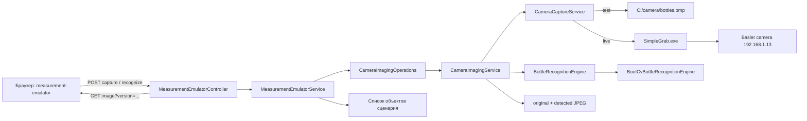
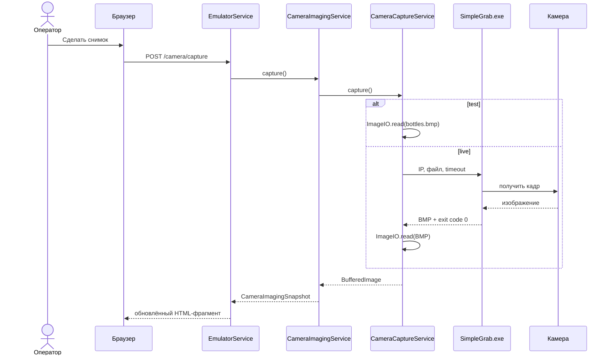
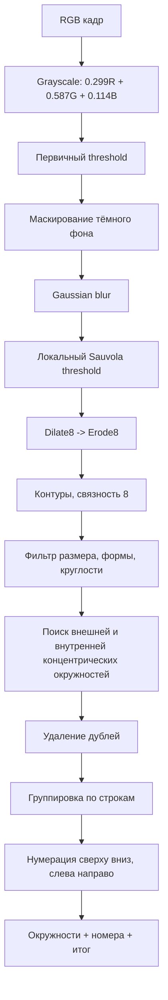
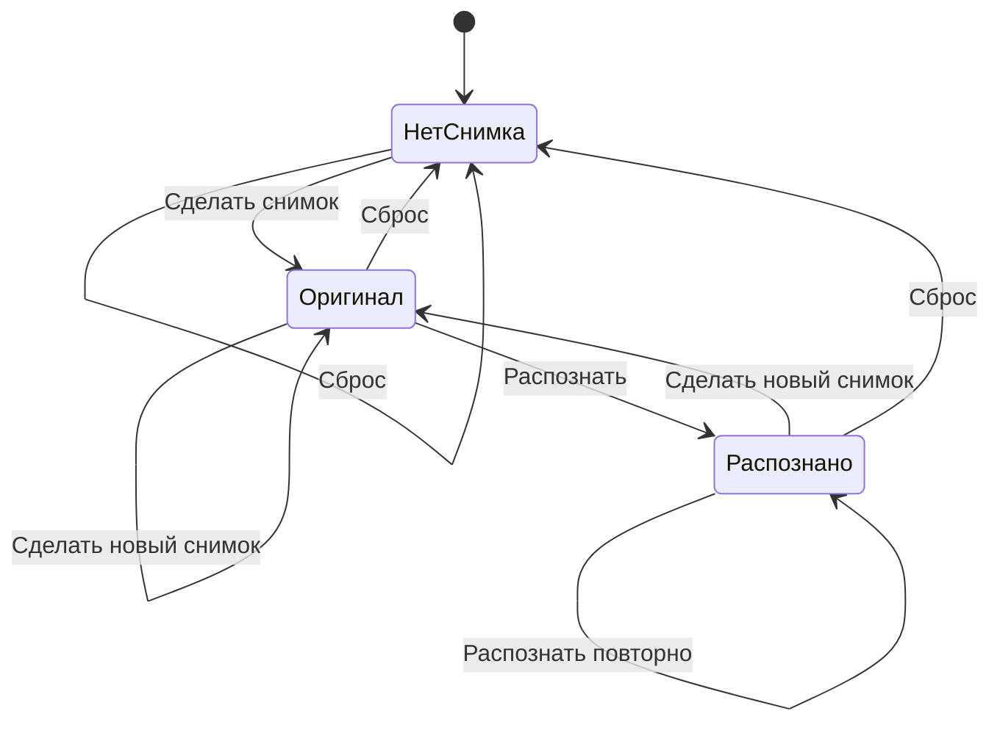
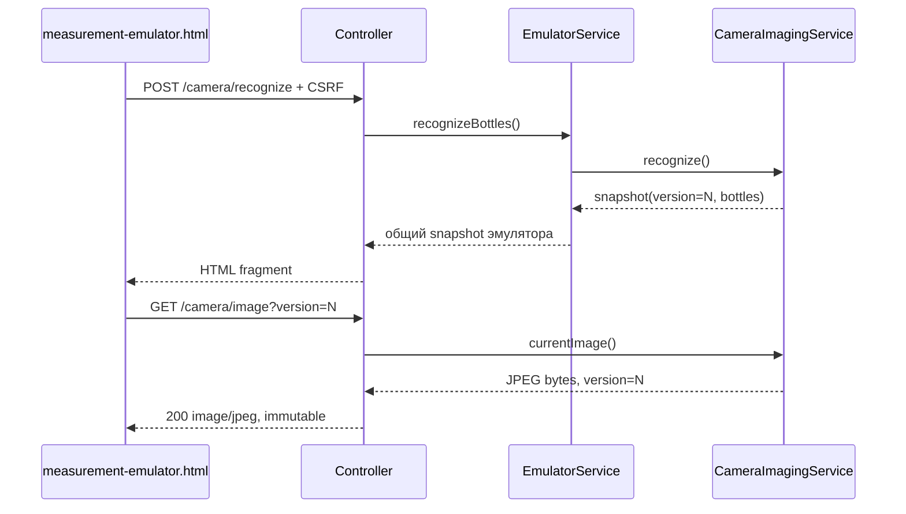
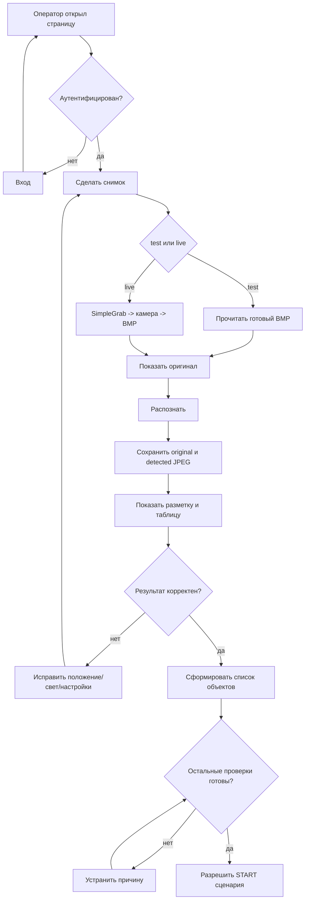

# RGSCenter: руководство по сервису камеры

Версия документа: 1.0

Дата: 24.08.2026

Проверенная ревизия проекта: `0f60d1d`

Подсистема: `com.rgs.center.camera` и интеграция с `measurement.emulator`

## 1. Назначение

Подсистема камеры получает одиночный кадр машинного зрения, распознаёт бутылки по круглым концентрическим контурам крышек, формирует пронумерованный список объектов, показывает результат оператору и сохраняет оригинальный и размеченный JPEG-файлы.

Сервис поддерживает два режима без пересборки JAR:

- `test` — читает заранее подготовленный файл `C:/camera/bottles.bmp`, не обращаясь к физической камере;
- `live` — запускает `C:/SimpleGrab/SimpleGrab.exe`, передаёт IP камеры, имя выходного файла и тайм-аут, затем читает полученный кадр.

Подсистема встроена в страницу `/measurement-emulator`. Доступ к странице и связанным endpoint требует аутентификации.

## 2. Границы ответственности

Сервис камеры отвечает за:

1. получение одного кадра;
2. хранение текущего оригинала в памяти процесса;
3. распознавание бутылок;
4. нумерацию объектов сверху вниз и слева направо;
5. нанесение окружностей и номеров;
6. сохранение двух JPEG-файлов;
7. выдачу текущего изображения браузеру;
8. передачу списка объектов эмулятору измерительного сценария;
9. сообщения оператору и диагностическое логирование.

Сервис не отвечает за непрерывный видеопоток, управление параметрами экспозиции камеры, движение манипулятора, чтение штрих-кода и долговременное хранение результатов измерений в БД.

## 3. Архитектура



Основная идея: интерфейс `CameraImagingOperations` отделяет эмулятор от конкретной реализации захвата и распознавания. `CameraCaptureService` не знает о web-интерфейсе, а алгоритм `BoofCvBottleRecognitionEngine` не знает, откуда пришло изображение и куда оно будет сохранено.

## 4. Структура исходников

| Файл | Роль |
|---|---|
| `camera/CameraCaptureService.java` | Получение кадра в `test` или `live` режиме |
| `camera/CameraImagingOperations.java` | Публичный контракт подсистемы |
| `camera/CameraImagingService.java` | Координация кадра, распознавания, состояния и JPEG |
| `camera/BottleRecognitionEngine.java` | Контракт алгоритма распознавания |
| `camera/BoofCvBottleRecognitionEngine.java` | Реализация распознавания на BoofCV |
| `camera/DetectedBottle.java` | Геометрия и номер найденной бутылки |
| `camera/BottleRecognitionResult.java` | Размеченное изображение и список бутылок |
| `camera/CameraImagingSnapshot.java` | Неизменяемое состояние окна камеры |
| `camera/CameraImagePayload.java` | Защитная передача байтов JPEG в HTTP-слой |
| `camera/CameraImagingException.java` | Ошибки подсистемы камеры |
| `measurement/emulator/MeasurementEmulatorController.java` | HTML и бинарные endpoint камеры |
| `measurement/emulator/MeasurementEmulatorService.java` | Связь распознавания со списком объектов и журналом |
| `templates/measurement-emulator.html` | Страница, JavaScript-команды и автообновление |
| `templates/fragments/measurement-emulator-status.html` | Окно камеры, таблица результата, файлы и журнал |

## 5. Получение снимка

### 5.1 Метод `CameraCaptureService.capture()`

Метод возвращает `BufferedImage`.

- В `test` режиме сразу проверяется и читается `rgs.camera.capture-file`.
- В `live` режиме сначала вызывается приватный `runSimpleGrab()`, после чего читается тот же выходной файл.
- Отсутствующий файл, неподдерживаемый формат и ошибка чтения преобразуются в `CameraImagingException` с понятным сообщением.

### 5.2 Рабочий режим `live`

`runSimpleGrab()`:

1. проверяет существование EXE;
2. создаёт каталог выходного BMP при необходимости;
3. запускает процесс с аргументами:
   `SimpleGrab.exe <cameraIp> <captureFile> <timeoutMillis>`;
4. объединяет stderr со stdout и отбрасывает вывод, чтобы внешний процесс не заблокировался на заполненном буфере;
5. ждёт завершения не более `timeout + 2 секунды`;
6. при зависании принудительно завершает процесс;
7. проверяет код возврата;
8. сохраняет флаг прерывания потока при `InterruptedException`.



## 6. Управление текущим изображением

`CameraImagingService` хранит состояние в памяти:

- `originalImage` — неизменённый текущий кадр;
- `displayedImage` — JPEG, который выдаётся браузеру; сначала оригинал, после распознавания — размеченная копия;
- `imageVersion` — версия изображения для уникального URL;
- `recognized` — признак завершённого распознавания;
- `message` — сообщение оператору;
- `originalFile`, `detectedFile` — пути архивных JPEG;
- `bottles` — неизменяемый список обнаружений.

Все публичные операции сервиса объявлены `synchronized`. Это не позволяет одновременному HTTP-запросу получить частично обновлённое состояние во время снимка, распознавания или сброса.

### 6.1 `capture()`

1. получает кадр;
2. создаёт RGB-копию;
3. кодирует JPEG для браузера;
4. увеличивает версию URL;
5. сбрасывает старые результаты и имена файлов;
6. записывает сообщение и INFO-лог;
7. возвращает согласованный `CameraImagingSnapshot`.

Новый снимок всегда отменяет результат предыдущего распознавания.

### 6.2 `recognize()`

1. требует ранее полученный `originalImage`;
2. передаёт копию в `BottleRecognitionEngine`;
3. создаёт выходной каталог;
4. сохраняет оригинал `bottles_<date>_<time>.jpeg`;
5. сохраняет разметку `bottles_detected_<date>_<time>.jpeg`;
6. кодирует разметку для браузера;
7. увеличивает `imageVersion`;
8. публикует список бутылок и сообщение.

Формат времени: `yyyyMMdd_HHmmss_SSS`, например `bottles_20260824_143527_184.jpeg`.

Запись выполняется через временный файл и последующее атомарное перемещение. Если файловая система не поддерживает `ATOMIC_MOVE`, используется обычное перемещение. Незавершённый временный файл удаляется.

### 6.3 `snapshot()`, `currentImage()`, `reset()`

- `snapshot()` возвращает метаданные окна без изменения состояния.
- `currentImage()` возвращает `Optional<CameraImagePayload>`; до первого снимка значение отсутствует.
- `reset()` очищает состояние окна и список бутылок, но не удаляет архивные JPEG.

`CameraImagePayload` копирует массив байтов при создании и при чтении. Внешний код не может изменить сохранённое изображение через ссылку на массив.

## 7. Алгоритм распознавания

Алгоритм перенесён из проекта `SilouttesDetection` и реализован с использованием BoofCV 1.1.2.



### 7.1 Преобразование в серый

Для каждого пикселя применяется целочисленная формула:

`gray = (299 * R + 587 * G + 114 * B) / 1000`.

### 7.2 Первичная маска и размытие

Глобальный порог отделяет слишком тёмные области. Затем изображение размывается Gaussian-фильтром. Это уменьшает влияние мелкого шума и надписей на крышках.

### 7.3 Локальная бинаризация Sauvola

Локальный порог адаптируется к освещению в окрестности каждого пикселя. Это полезно при неравномерной подсветке рабочей зоны.

### 7.4 Морфология

Последовательность `dilate8` и `erode8` закрывает небольшие разрывы бинарного контура. Используется восьмисвязная окрестность.

### 7.5 Формирование кандидатов

Для внешних и внутренних контуров вычисляются:

- ограничивающий прямоугольник;
- центр;
- ширина и высота;
- средний диаметр `(width + height) / 2`;
- площадь по формуле многоугольника;
- периметр;
- круглость `4 * PI * area / perimeter²`.

Кандидат отклоняется, если не проходит ограничения по числу точек, диаметру, отношению сторон или круглости.

### 7.6 Признак бутылки

Крышка считается бутылкой, если существует меньший контур:

- его диаметр находится в допустимой доле от внешнего;
- расстояние между центрами относительно внешнего диаметра не превышает порог;
- внешний и внутренний контуры являются концентрическими в заданном допуске.

После этого совпадающие кандидаты удаляются по нормализованному расстоянию между центрами.

### 7.7 Порядок нумерации

Нумерация не зависит от диаметра крышки. Метод `numberByRows()`:

1. предварительно сортирует объекты по `centerY`, затем по `centerX`;
2. помещает объект в ближайшую подходящую горизонтальную строку;
3. допуск строки рассчитывает из средней высоты уже принятых объектов и высоты нового объекта;
4. сортирует строки по средней координате Y;
5. сортирует бутылки каждой строки по X;
6. присваивает номера `1..N`.

Таким образом, порядок читается как текст: строки сверху вниз, внутри строки слева направо. Коэффициент допуска строки `ROW_CENTER_TOLERANCE_RATIO = 0.75` сейчас является константой кода.

### 7.8 Разметка результата

На RGB-копии кадра рисуются:

- зелёная окружность толщиной 4 px;
- номер бутылки зелёным полужирным шрифтом 54 px на полупрозрачном чёрном фоне;
- итог `Найдено бутылок: N` шрифтом 22 px.

Оригинальный кадр при этом не изменяется.

## 8. Параметры распознавания

| Свойство | По умолчанию | Назначение |
|---|---:|---|
| `rgs.camera.detection.initial-threshold` | 40 | Глобальное отсечение тёмного фона |
| `rgs.camera.detection.blur-radius` | 5 | Радиус Gaussian-размытия |
| `rgs.camera.detection.sauvola-radius` | 20 | Размер локальной области Sauvola |
| `rgs.camera.detection.sauvola-k` | 0.005 | Чувствительность локального порога |
| `rgs.camera.detection.morphology-radius` | 2 | Радиус dilate/erode |
| `rgs.camera.detection.contour-points-min` | 40 | Минимум точек контура |
| `rgs.camera.detection.diameter-min` | 20 | Минимальный диаметр, px |
| `rgs.camera.detection.diameter-max` | 180 | Максимальный диаметр, px |
| `rgs.camera.detection.aspect-ratio-min` | 0.78 | Минимальное `width/height` |
| `rgs.camera.detection.aspect-ratio-max` | 1.22 | Максимальное `width/height` |
| `rgs.camera.detection.circularity-min` | 0.55 | Минимальная круглость |
| `rgs.camera.detection.concentric-center-distance-ratio-max` | 0.18 | Допуск центров колец |
| `rgs.camera.detection.inner-to-outer-ratio-min` | 0.30 | Минимальная доля внутреннего диаметра |
| `rgs.camera.detection.inner-to-outer-ratio-max` | 0.90 | Максимальная доля внутреннего диаметра |
| `rgs.camera.detection.duplicate-center-distance-ratio-max` | 0.35 | Порог удаления дублей |

Менять параметры следует по одному и проверять на эталонном наборе изображений. Уменьшение ограничений повышает чувствительность и риск ложных срабатываний; увеличение — снижает ложные срабатывания, но может пропустить бутылки.

## 9. Контракт данных

### `DetectedBottle`

| Поле | Тип | Значение |
|---|---|---|
| `number` | `int` | Порядковый номер для UI и сценария |
| `centerX`, `centerY` | `double` | Центр контура в пикселях исходного кадра |
| `width`, `height` | `int` | Габариты контура |
| `diameter` | `double` | Средний диаметр |
| `circularity` | `double` | Круглость, около 1 для идеального круга |

### `CameraImagingSnapshot`

Содержит наличие изображения, версию URL, признак распознавания, сообщение, пути двух файлов и список `DetectedBottle`. Record используется как неизменяемая согласованная витрина текущего состояния.

## 10. Интеграция с измерительным эмулятором

`MeasurementEmulatorService.captureCameraImage()` запрещает снимок во время фазы `RUNNING`, вызывает сервис камеры, очищает старый список объектов и добавляет событие.

`recognizeBottles()` также запрещён во время `RUNNING`. После успешного распознавания для каждой бутылки создаётся объект сценария:

- номер — из `DetectedBottle.number`;
- штрих-код — `НЕ СЧИТАН`;
- масса — `0.0`;
- статус — `ОБНАРУЖЕН`.

В журнал добавляются итог распознавания и пути сохранённых файлов. Непустой список объектов участвует в условии доступности кнопки `START`.



## 11. HTTP-интерфейс

Базовый путь: `/measurement-emulator`. Все маршруты защищены общей аутентификацией Spring Security. POST-запросы используют CSRF-заголовок.

| Метод и путь | Ответ | Назначение |
|---|---|---|
| `GET /measurement-emulator` | полная HTML-страница | Открытие эмулятора |
| `GET /measurement-emulator/status` | HTML-фрагмент | Обновление состояния без перезагрузки страницы |
| `POST /measurement-emulator/camera/capture` | HTML-фрагмент | Получить новый кадр |
| `POST /measurement-emulator/camera/recognize` | HTML-фрагмент | Распознать текущий кадр |
| `POST /measurement-emulator/detect-objects` | HTML-фрагмент | Совместимый старый маршрут распознавания |
| `GET /measurement-emulator/camera/image?version=N` | `image/jpeg` или 404 | Получить текущий оригинал/разметку |
| `POST /measurement-emulator/reset` | HTML-фрагмент | Очистить состояние окна и эмулятора |

Endpoint изображения возвращает байты только при точном совпадении параметра `version` с текущей версией. Ответ имеет неизменяемый публичный cache-control на 365 дней. При каждом изменении кадра создаётся новый URL, поэтому браузер безопасно кэширует старые версии и сразу получает новую.



## 12. Web-интерфейс оператора

В карточке «Изображение камеры» находятся:

- область последнего изображения;
- кнопка «Сделать снимок»;
- кнопка «Распознать», отключённая до первого кадра.

После распознавания в области изображения показывается размеченный JPEG. Ниже выводятся:

- текстовый итог;
- таблица `№`, `Центр X`, `Центр Y`, `Размер`, `Круглость`;
- пояснение единиц измерения;
- пути оригинала и результата;
- список объектов измерительного сценария;
- журнал событий.

JavaScript-функция `emulatorAction(path)` выполняет POST, передаёт CSRF-заголовки и заменяет содержимое панели возвращённым Thymeleaf-фрагментом. `loadEmulatorStatus()` обновляет панель каждую секунду через `setInterval`, если команда оператора не выполняется. Флаг `emulatorActionPending` предотвращает наложение фонового обновления на активную команду.

## 13. Конфигурация и запуск

Основные свойства:

```properties
rgs.device.camera.ip=192.168.1.13
rgs.camera.capture-mode=test
rgs.camera.capture-file=C:/camera/bottles.bmp
rgs.camera.output-directory=C:/camera
rgs.camera.capture-executable=C:/SimpleGrab/SimpleGrab.exe
rgs.camera.capture-timeout-millis=10000
```

Spring Boot преобразует имена переменных окружения верхнего регистра с подчёркиваниями в свойства. Пересборка JAR не нужна; приложение необходимо перезапустить.

CMD, тестовый режим:

```cmd
set RGS_CAMERA_CAPTURE_MODE=test
set RGS_CAMERA_CAPTURE_FILE=C:\camera\bottles.bmp
java -jar center-0.0.1-SNAPSHOT.jar
```

CMD, рабочий режим:

```cmd
set RGS_CAMERA_CAPTURE_MODE=live
set RGS_DEVICE_CAMERA_IP=192.168.1.13
set RGS_CAMERA_CAPTURE_EXECUTABLE=C:\SimpleGrab\SimpleGrab.exe
set RGS_CAMERA_CAPTURE_TIMEOUT_MILLIS=20000
java -jar center-0.0.1-SNAPSHOT.jar
```

PowerShell:

```powershell
$env:RGS_CAMERA_CAPTURE_MODE = "live"
$env:RGS_CAMERA_CAPTURE_TIMEOUT_MILLIS = "20000"
java -jar .\center-0.0.1-SNAPSHOT.jar
```

Переменная, заданная через `set`, действует только в текущем окне CMD. Для постоянной системной настройки можно использовать внешнюю конфигурацию Spring Boot или `setx`, учитывая, что новое значение `setx` появится только в новом процессе.

## 14. Работа оператора

1. Открыть `/measurement-emulator` и войти в систему.
2. Убедиться, что измерительный цикл не находится в `RUNNING`.
3. Нажать «Сделать снимок».
4. Проверить, что появился актуальный кадр и сообщение об успехе.
5. Нажать «Распознать».
6. Сравнить окружности и номера с физическим расположением бутылок.
7. Проверить количество и таблицу координат.
8. При ложном или пропущенном объекте исправить положение/освещение, сделать новый снимок и повторить распознавание.
9. Убедиться, что сформирован список объектов сценария.
10. Переходить к `START` только после прохождения остальных проверок комплекса.

## 15. Ошибки и диагностика

| Симптом | Возможная причина | Проверка/действие |
|---|---|---|
| «Файл снимка не найден» | Неверный путь или SimpleGrab не создал BMP | Проверить `capture-file`, права и код возврата EXE |
| «Утилита захвата не найдена» | Неверный путь к EXE | Проверить `capture-executable` |
| «Превышено время ожидания» | Камера/сеть/EXE не ответили | Проверить IP, кабель, firewall; увеличить timeout обоснованно |
| `SimpleGrab завершился с кодом N` | Ошибка внешней утилиты | Запустить EXE вручную с теми же аргументами |
| «Формат снимка не поддерживается» | Повреждённый или неверный файл | Открыть файл локально, проверить BMP/JPEG |
| «Сначала сделайте снимок» | Распознавание вызвано до capture | Сначала нажать «Сделать снимок» |
| Бутылки не обнаружены | Пороги, масштаб, контраст, геометрия | Проверить свет, фокус, размер крышек и параметры детектора |
| Ложные окружности | Слишком мягкие фильтры | Повысить `circularity-min`, сузить диаметры/отношения |
| Старое изображение | Несогласованный version или старый HTML | Проверить `/status`, версию URL, сетевые ошибки браузера |
| JPEG не сохраняется | Нет прав на каталог | Проверить `output-directory` и свободное место |

Логируются успешный снимок, режим, размер кадра, число найденных бутылок, имена файлов и предупреждения с краткой причиной. Сырые байты изображений и полный вывод SimpleGrab в журнал не записываются, поэтому лог не переполняется изображениями.

## 16. Потоки, память и производительность

- HTTP-команды выполняются в потоках web-сервера.
- Получение live-кадра синхронно ждёт внешний процесс; это одиночная операторская операция, не периодический видеопоток.
- `CameraImagingService` сериализует операции монитором объекта через `synchronized`.
- В памяти находятся исходный `BufferedImage`, JPEG текущего отображения и список объектов.
- При новом кадре старые ссылки заменяются и могут быть освобождены GC.
- Архивные JPEG автоматически не удаляются; требуется политика хранения.
- Периодическое обновление HTML не запускает новый снимок и не запускает распознавание.

## 17. Тестирование

`BoofCvBottleRecognitionEngineTests` проверяет:

- безопасную обработку пустого кадра;
- порядок нумерации по строкам сверху вниз и слева направо.

`CameraImagingServiceTests` проверяет:

- получение кадра;
- распознавание;
- сохранение оригинала и результата;
- формирование снимка состояния;
- поведение без исходного кадра.

`MeasurementEmulatorWebTests` проверяет web-маршруты и интеграцию HTML-слоя.

Рекомендуемый регрессионный набор для промышленной настройки должен содержать разные варианты освещения, заполненности, поворота камеры, перекрытий, пустой стол и посторонние круглые предметы. Для каждого кадра следует хранить ожидаемое число бутылок и допустимые координаты.

## 18. Ограничения текущей реализации

1. `live` зависит от внешней утилиты SimpleGrab и её контракта аргументов.
2. Выполняется одиночный кадр, не потоковое видео.
3. Параметры распознавания глобальны для всех условий.
4. Критерий основан на круглых концентрических контурах крышки; бутылка без видимой крышки не распознаётся.
5. Коэффициент группировки строк и размер шрифта заданы константами кода.
6. Нет автоматической очистки архива JPEG.
7. Нет БД с историей распознаваний и привязкой к измерительному запуску.
8. Нет оценки уверенности, кроме доступной геометрии и круглости.
9. Нет отдельного endpoint состояния камеры вне страницы эмулятора.
10. Ошибка распознавания отображается через журнал/сообщение эмулятора, а HTTP-фрагмент обычно остаётся успешно сформированным.

## 19. Рекомендуемые улучшения

Приоритет 1:

- вынести размер номера и допуск строки в `application.properties`;
- добавить идентификатор измерительного запуска в имена/метаданные файлов;
- ввести лимит возраста/объёма архива;
- добавить тестовый каталог размеченных эталонов и метрики precision/recall;
- проверять свежесть BMP после завершения SimpleGrab, чтобы не прочитать старый файл.

Приоритет 2:

- перенести длительный live-захват и распознавание в отдельный executor с состояниями `CAPTURING/RECOGNIZING`;
- добавить endpoint диагностического состояния: режим, последний успех, длительность, размер кадра, ошибка;
- сохранять параметры детектора вместе с результатом;
- добавить масштабирование координат в физическую систему рабочего стола после калибровки камеры;
- реализовать ручное подтверждение/исправление списка оператором.

Приоритет 3:

- абстрагировать адаптер захвата, чтобы заменить SimpleGrab без изменения бизнес-сервиса;
- поддержать несколько камер;
- добавить контроль качества кадра: резкость, пересвет, тени, закрытие зоны;
- реализовать версионированный формат результата для передачи в автоматический сценарий.

## 20. Карта основных методов

| Класс | Метод | Назначение |
|---|---|---|
| `CameraCaptureService` | `capture()` | Получить и декодировать кадр |
| `CameraCaptureService` | `runSimpleGrab()` | Запустить live-захват с тайм-аутом |
| `CameraImagingService` | `capture()` | Сделать кадр текущим и очистить старый результат |
| `CameraImagingService` | `recognize()` | Распознать, сохранить и опубликовать результат |
| `CameraImagingService` | `snapshot()` | Получить согласованное состояние |
| `CameraImagingService` | `currentImage()` | Получить текущий JPEG для HTTP |
| `CameraImagingService` | `reset()` | Очистить состояние без удаления архива |
| `BoofCvBottleRecognitionEngine` | `recognize()` | Выполнить полный CV-конвейер |
| `BoofCvBottleRecognitionEngine` | `createCandidate()` | Рассчитать геометрию и отфильтровать контур |
| `BoofCvBottleRecognitionEngine` | `concentricRings()` | Выбрать концентрические пары и удалить дубли |
| `BoofCvBottleRecognitionEngine` | `numberByRows()` | Назначить порядок сверху вниз/слева направо |
| `BoofCvBottleRecognitionEngine` | `annotate()` | Нарисовать окружности, номера и итог |
| `MeasurementEmulatorService` | `captureCameraImage()` | Интегрировать снимок с состоянием сценария |
| `MeasurementEmulatorService` | `recognizeBottles()` | Сформировать список объектов и журнал |
| `MeasurementEmulatorController` | `cameraImage()` | Отдать versioned JPEG браузеру |

## 21. Контрольный список перед вводом на NuvoPC

- [ ] Java и JAR установлены и запускаются под сервисной учётной записью.
- [ ] `SimpleGrab.exe` существует и запускается той же учётной записью.
- [ ] Камера доступна по `192.168.1.13`.
- [ ] Каталог `C:/camera` существует или может быть создан.
- [ ] Есть права чтения/записи и достаточно места.
- [ ] `RGS_CAMERA_CAPTURE_MODE=live` установлен в окружении процесса сервиса.
- [ ] Тайм-аут соответствует реальному времени ответа.
- [ ] Сделан контрольный снимок и проверено, что файл обновился.
- [ ] Проверено распознавание полного и частичного набора бутылок.
- [ ] Проверена нумерация по строкам.
- [ ] Проверены сообщения при отключённой камере и недоступном EXE.
- [ ] Настроено резервное копирование или удаление старых JPEG.

## 22. Итоговая схема рабочего алгоритма



## 23. Связанные исходники

- `center/src/main/java/com/rgs/center/camera/`
- `center/src/main/java/com/rgs/center/measurement/emulator/MeasurementEmulatorController.java`
- `center/src/main/java/com/rgs/center/measurement/emulator/MeasurementEmulatorService.java`
- `center/src/main/resources/templates/measurement-emulator.html`
- `center/src/main/resources/templates/fragments/measurement-emulator-status.html`
- `center/src/main/resources/application.properties`
- `center/src/test/java/com/rgs/center/camera/`
- `center/src/test/java/com/rgs/center/measurement/emulator/MeasurementEmulatorWebTests.java`
